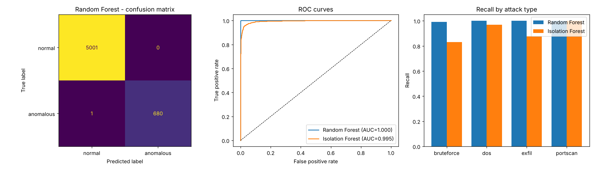

# AI-Based Network Traffic Anomaly Detector

   

A prototype that learns what normal network traffic looks like and flags unusual
flows using machine learning. It combines ML with networking and cybersecurity
fundamentals (TCP flags, connection rates, port diversity, byte/packet volume).

## How it works

1. **Flow features** (`data.py`) - each record is one network flow described by
   duration, protocol, service, bytes/packets in each direction, SYN/RST ratios,
   connections-per-2s window, distinct destination ports, and error rate.
   Four attack families are simulated: **DoS flood, port scan, brute force,
   data exfiltration**; ~40% are "stealthy" variants blended toward normal.
2. **Preprocessing** - `log1p` to tame heavy-tailed counts, robust scaling,
   one-hot encoding for protocol/service.
3. **Two detectors** (`train.py`)
   - **Random Forest** (supervised): normal vs. anomalous, learns known attack patterns.
   - **Isolation Forest** (unsupervised): trained on *normal traffic only*; flags
     statistical outliers, so it can surface attacks it has never seen.
4. **Scoring** (`detect.py`) - combines both: `ANOMALY (known pattern)` from the
   classifier, `ANOMALY (novel/outlier)` from the isolation forest.

## Run it

```bash
pip install -r requirements.txt
python train.py            # trains, evaluates, saves artifacts/
python detect.py --demo    # score a fresh batch of synthetic traffic
python detect.py my_flows.csv   # score your own CSV (columns listed in data.py FEATURES)
```

`train.py` writes `artifacts/evaluation.png` (confusion matrix, ROC curves,
per-attack recall), `feature_importance.png`, `metrics.json` and `model.joblib`.

Sample outputs from one run (`evaluation.png`, `feature_importance.png`, `metrics.json`, `model.joblib`) are included in the repo root. Running `train.py` regenerates them inside `artifacts/`.

## Results (synthetic data, 22.7k flows, 12% anomalous)

| Model | Precision | Recall | F1 | ROC-AUC |
|---|---|---|---|---|
| Random Forest | ~1.00 | ~1.00 | ~1.00 | ~1.00 |
| Isolation Forest (normal-only) | 0.87 | 0.94 | 0.90 | 0.995 |

**Important caveat:** the data is synthetic, so these numbers are optimistic and
should not be presented as real-world accuracy. To get credible results, train on
a public dataset such as **NSL-KDD** or **CIC-IDS2017**: map its columns to the
`FEATURES` list in `data.py` (or edit `NUMERIC`/`CATEGORICAL`) and run
`python train.py --csv your_dataset.csv`. The CSV needs `is_anomaly` (0/1) and `label` columns.

## Ideas to extend

- Real packet capture -> flow features with Zeek, CICFlowMeter or Scapy
- Autoencoder / LSTM for sequence-based detection
- Streaming/live detection and a dashboard
- Threshold tuning against a target false-positive rate
